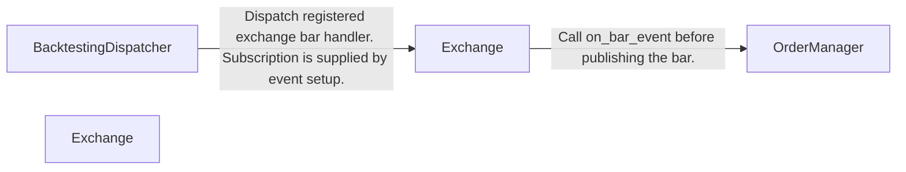
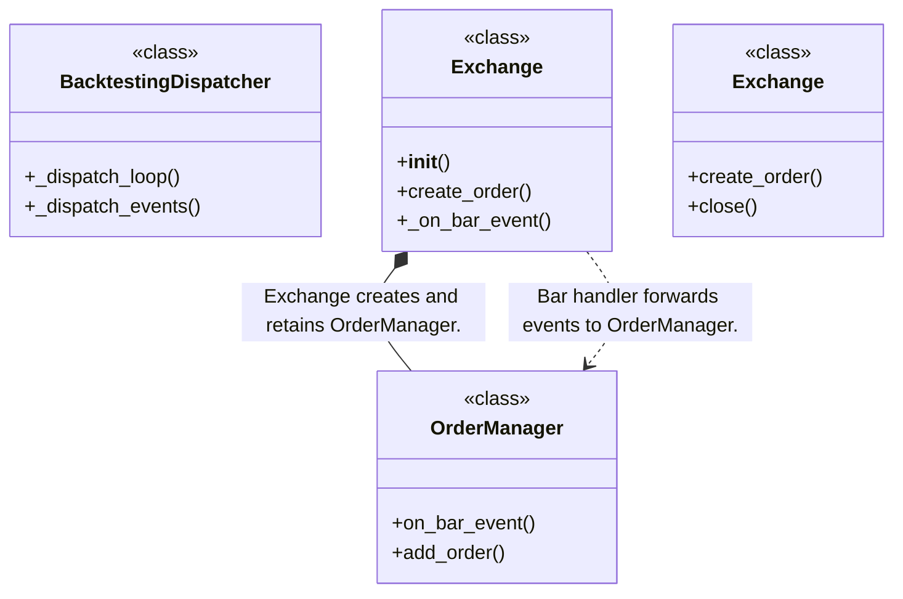
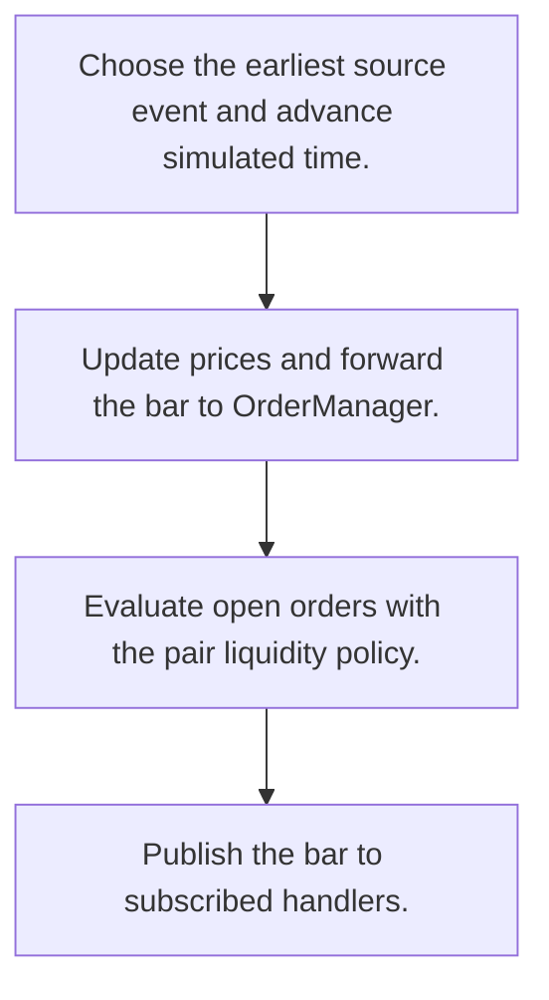
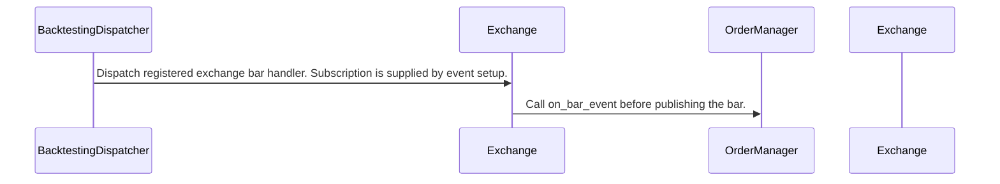

# Basana: workflow, design and architecture

Updated: **2026-10-13**
Reviewed Git hash: `7eb2c1c3a67bd569d1bff695609c87e3f30bca32`
Branch: `feature/ayu_develop`
Source diff SHA256: `e3b0c44298fc1c149afbf4c8996fb92427ae41e4649b934ca495991b7852b855`
Scope: **Asynchronous event trading framework** / Maintenance: **active**
Languages: Python

[HTML edition](ayu-develop.html) / [Development](development.md) / [Historical validation](validation.md) / [Full system comparison](../../docs/index.html)

## Purpose and scope

Dispatch asynchronous trading events and simulate exchange balances and orders, with external exchange adapters.

## Features and support boundaries

Native = implemented here. Integration = supplied through a named host/API. Limited = material restriction. Not provided = evidenced scope exclusion. Unverified = support/absence not established. Not applicable = outside this artifact type.

| Capability | Status | Implementation and limits | Source |
|---|---|---|---|
| Backtesting | Native | Simulated clock and configurable exchange matching. | [BacktestingDispatcher._dispatch_loop](../src/basana/core/dispatcher/backtesting.py) ([L55](https://github.com/alexcwyu/basana/blob/7eb2c1c3a67bd569d1bff695609c87e3f30bca32/src/basana/core/dispatcher/backtesting.py#L55)) / [BacktestingDispatcher._dispatch_events](../src/basana/core/dispatcher/backtesting.py) ([L91](https://github.com/alexcwyu/basana/blob/7eb2c1c3a67bd569d1bff695609c87e3f30bca32/src/basana/core/dispatcher/backtesting.py#L91)) / [Exchange.__init__](../src/basana/backtesting/exchange.py) ([L98](https://github.com/alexcwyu/basana/blob/7eb2c1c3a67bd569d1bff695609c87e3f30bca32/src/basana/backtesting/exchange.py#L98)) / [Exchange.create_order](../src/basana/backtesting/exchange.py) ([L160](https://github.com/alexcwyu/basana/blob/7eb2c1c3a67bd569d1bff695609c87e3f30bca32/src/basana/backtesting/exchange.py#L160)) / [Exchange._on_bar_event](../src/basana/backtesting/exchange.py) ([L438](https://github.com/alexcwyu/basana/blob/7eb2c1c3a67bd569d1bff695609c87e3f30bca32/src/basana/backtesting/exchange.py#L438)) / [OrderManager.on_bar_event](../src/basana/backtesting/order_mgr.py) ([L87](https://github.com/alexcwyu/basana/blob/7eb2c1c3a67bd569d1bff695609c87e3f30bca32/src/basana/backtesting/order_mgr.py#L87)) / [OrderManager.add_order](../src/basana/backtesting/order_mgr.py) ([L93](https://github.com/alexcwyu/basana/blob/7eb2c1c3a67bd569d1bff695609c87e3f30bca32/src/basana/backtesting/order_mgr.py#L93)) |
| Live execution | Integration | CCXT client requests are delegated to an external exchange API. No live operation was performed. | [Exchange.create_order](../src/basana/external/ccxt/exchange.py) ([L271](https://github.com/alexcwyu/basana/blob/7eb2c1c3a67bd569d1bff695609c87e3f30bca32/src/basana/external/ccxt/exchange.py#L271)) / [Exchange.close](../src/basana/external/ccxt/exchange.py) ([L522](https://github.com/alexcwyu/basana/blob/7eb2c1c3a67bd569d1bff695609c87e3f30bca32/src/basana/external/ccxt/exchange.py#L522)) |
| Paper trading | Limited | Native backtesting Exchange simulates balances and order fills. A realtime paper mode was not substantiated. | [Exchange.__init__](../src/basana/backtesting/exchange.py) ([L98](https://github.com/alexcwyu/basana/blob/7eb2c1c3a67bd569d1bff695609c87e3f30bca32/src/basana/backtesting/exchange.py#L98)) / [Exchange.create_order](../src/basana/backtesting/exchange.py) ([L160](https://github.com/alexcwyu/basana/blob/7eb2c1c3a67bd569d1bff695609c87e3f30bca32/src/basana/backtesting/exchange.py#L160)) / [Exchange._on_bar_event](../src/basana/backtesting/exchange.py) ([L438](https://github.com/alexcwyu/basana/blob/7eb2c1c3a67bd569d1bff695609c87e3f30bca32/src/basana/backtesting/exchange.py#L438)) |
| Event driven | Native | Timestamped events and asynchronous handler dispatch. | [BacktestingDispatcher._dispatch_loop](../src/basana/core/dispatcher/backtesting.py) ([L55](https://github.com/alexcwyu/basana/blob/7eb2c1c3a67bd569d1bff695609c87e3f30bca32/src/basana/core/dispatcher/backtesting.py#L55)) / [BacktestingDispatcher._dispatch_events](../src/basana/core/dispatcher/backtesting.py) ([L91](https://github.com/alexcwyu/basana/blob/7eb2c1c3a67bd569d1bff695609c87e3f30bca32/src/basana/core/dispatcher/backtesting.py#L91)) |
| Vectorized | Unverified | The inspected source does not establish this capability. This is not a claim of absence. | Not applicable to this repository scope. |
| Order management | Native | Validated order registration and per-pair open-order processing. | [Exchange.__init__](../src/basana/backtesting/exchange.py) ([L98](https://github.com/alexcwyu/basana/blob/7eb2c1c3a67bd569d1bff695609c87e3f30bca32/src/basana/backtesting/exchange.py#L98)) / [Exchange.create_order](../src/basana/backtesting/exchange.py) ([L160](https://github.com/alexcwyu/basana/blob/7eb2c1c3a67bd569d1bff695609c87e3f30bca32/src/basana/backtesting/exchange.py#L160)) / [Exchange._on_bar_event](../src/basana/backtesting/exchange.py) ([L438](https://github.com/alexcwyu/basana/blob/7eb2c1c3a67bd569d1bff695609c87e3f30bca32/src/basana/backtesting/exchange.py#L438)) / [OrderManager.on_bar_event](../src/basana/backtesting/order_mgr.py) ([L87](https://github.com/alexcwyu/basana/blob/7eb2c1c3a67bd569d1bff695609c87e3f30bca32/src/basana/backtesting/order_mgr.py#L87)) / [OrderManager.add_order](../src/basana/backtesting/order_mgr.py) ([L93](https://github.com/alexcwyu/basana/blob/7eb2c1c3a67bd569d1bff695609c87e3f30bca32/src/basana/backtesting/order_mgr.py#L93)) |
| Order types | Native | Exchange exposes market, limit, stop and stop-limit request methods. Matching is performed by OrderManager. | [Exchange.__init__](../src/basana/backtesting/exchange.py) ([L98](https://github.com/alexcwyu/basana/blob/7eb2c1c3a67bd569d1bff695609c87e3f30bca32/src/basana/backtesting/exchange.py#L98)) / [Exchange.create_order](../src/basana/backtesting/exchange.py) ([L160](https://github.com/alexcwyu/basana/blob/7eb2c1c3a67bd569d1bff695609c87e3f30bca32/src/basana/backtesting/exchange.py#L160)) / [Exchange._on_bar_event](../src/basana/backtesting/exchange.py) ([L438](https://github.com/alexcwyu/basana/blob/7eb2c1c3a67bd569d1bff695609c87e3f30bca32/src/basana/backtesting/exchange.py#L438)) / [OrderManager.on_bar_event](../src/basana/backtesting/order_mgr.py) ([L87](https://github.com/alexcwyu/basana/blob/7eb2c1c3a67bd569d1bff695609c87e3f30bca32/src/basana/backtesting/order_mgr.py#L87)) / [OrderManager.add_order](../src/basana/backtesting/order_mgr.py) ([L93](https://github.com/alexcwyu/basana/blob/7eb2c1c3a67bd569d1bff695609c87e3f30bca32/src/basana/backtesting/order_mgr.py#L93)) |
| Multi venue | Integration | External CCXT adapter accepts exchange-specific clients. Cross-venue orchestration remains application responsibility. | [Exchange.create_order](../src/basana/external/ccxt/exchange.py) ([L271](https://github.com/alexcwyu/basana/blob/7eb2c1c3a67bd569d1bff695609c87e3f30bca32/src/basana/external/ccxt/exchange.py#L271)) / [Exchange.close](../src/basana/external/ccxt/exchange.py) ([L522](https://github.com/alexcwyu/basana/blob/7eb2c1c3a67bd569d1bff695609c87e3f30bca32/src/basana/external/ccxt/exchange.py#L522)) |
| Crypto | Integration | CCXT Pro adapter and pair-based backtesting. | [Exchange.__init__](../src/basana/backtesting/exchange.py) ([L98](https://github.com/alexcwyu/basana/blob/7eb2c1c3a67bd569d1bff695609c87e3f30bca32/src/basana/backtesting/exchange.py#L98)) / [Exchange.create_order](../src/basana/backtesting/exchange.py) ([L160](https://github.com/alexcwyu/basana/blob/7eb2c1c3a67bd569d1bff695609c87e3f30bca32/src/basana/backtesting/exchange.py#L160)) / [Exchange._on_bar_event](../src/basana/backtesting/exchange.py) ([L438](https://github.com/alexcwyu/basana/blob/7eb2c1c3a67bd569d1bff695609c87e3f30bca32/src/basana/backtesting/exchange.py#L438)) / [Exchange.create_order](../src/basana/external/ccxt/exchange.py) ([L271](https://github.com/alexcwyu/basana/blob/7eb2c1c3a67bd569d1bff695609c87e3f30bca32/src/basana/external/ccxt/exchange.py#L271)) / [Exchange.close](../src/basana/external/ccxt/exchange.py) ([L522](https://github.com/alexcwyu/basana/blob/7eb2c1c3a67bd569d1bff695609c87e3f30bca32/src/basana/external/ccxt/exchange.py#L522)) |
| Equities | Unverified | The inspected source does not establish this capability. This is not a claim of absence. | Not applicable to this repository scope. |
| Futures | Unverified | The inspected source does not establish this capability. This is not a claim of absence. | Not applicable to this repository scope. |
| Options | Unverified | The inspected source does not establish this capability. This is not a claim of absence. | Not applicable to this repository scope. |
| Forex | Unverified | The inspected source does not establish this capability. This is not a claim of absence. | Not applicable to this repository scope. |
| Strategy api | Limited | Event subscriptions support user trading handlers. Strategy subclasses were outside this representative source set. | [BacktestingDispatcher._dispatch_loop](../src/basana/core/dispatcher/backtesting.py) ([L55](https://github.com/alexcwyu/basana/blob/7eb2c1c3a67bd569d1bff695609c87e3f30bca32/src/basana/core/dispatcher/backtesting.py#L55)) / [BacktestingDispatcher._dispatch_events](../src/basana/core/dispatcher/backtesting.py) ([L91](https://github.com/alexcwyu/basana/blob/7eb2c1c3a67bd569d1bff695609c87e3f30bca32/src/basana/core/dispatcher/backtesting.py#L91)) / [Exchange.__init__](../src/basana/backtesting/exchange.py) ([L98](https://github.com/alexcwyu/basana/blob/7eb2c1c3a67bd569d1bff695609c87e3f30bca32/src/basana/backtesting/exchange.py#L98)) / [Exchange.create_order](../src/basana/backtesting/exchange.py) ([L160](https://github.com/alexcwyu/basana/blob/7eb2c1c3a67bd569d1bff695609c87e3f30bca32/src/basana/backtesting/exchange.py#L160)) / [Exchange._on_bar_event](../src/basana/backtesting/exchange.py) ([L438](https://github.com/alexcwyu/basana/blob/7eb2c1c3a67bd569d1bff695609c87e3f30bca32/src/basana/backtesting/exchange.py#L438)) |
| Optimization | Unverified | The inspected source does not establish this capability. This is not a claim of absence. | Not applicable to this repository scope. |
| Machine learning | Unverified | The inspected source does not establish this capability. This is not a claim of absence. | Not applicable to this repository scope. |
| Reinforcement learning | Unverified | The inspected source does not establish this capability. This is not a claim of absence. | Not applicable to this repository scope. |
| Portfolio | Native | Decimal balances, fees and loan manager are composed by the simulator. | [Exchange.__init__](../src/basana/backtesting/exchange.py) ([L98](https://github.com/alexcwyu/basana/blob/7eb2c1c3a67bd569d1bff695609c87e3f30bca32/src/basana/backtesting/exchange.py#L98)) / [Exchange.create_order](../src/basana/backtesting/exchange.py) ([L160](https://github.com/alexcwyu/basana/blob/7eb2c1c3a67bd569d1bff695609c87e3f30bca32/src/basana/backtesting/exchange.py#L160)) / [Exchange._on_bar_event](../src/basana/backtesting/exchange.py) ([L438](https://github.com/alexcwyu/basana/blob/7eb2c1c3a67bd569d1bff695609c87e3f30bca32/src/basana/backtesting/exchange.py#L438)) |
| Risk management | Limited | Precision validation, configurable lending/liquidity and account balances. Strategy-level risk policy is application code. | [Exchange.__init__](../src/basana/backtesting/exchange.py) ([L98](https://github.com/alexcwyu/basana/blob/7eb2c1c3a67bd569d1bff695609c87e3f30bca32/src/basana/backtesting/exchange.py#L98)) / [Exchange.create_order](../src/basana/backtesting/exchange.py) ([L160](https://github.com/alexcwyu/basana/blob/7eb2c1c3a67bd569d1bff695609c87e3f30bca32/src/basana/backtesting/exchange.py#L160)) / [Exchange._on_bar_event](../src/basana/backtesting/exchange.py) ([L438](https://github.com/alexcwyu/basana/blob/7eb2c1c3a67bd569d1bff695609c87e3f30bca32/src/basana/backtesting/exchange.py#L438)) / [OrderManager.on_bar_event](../src/basana/backtesting/order_mgr.py) ([L87](https://github.com/alexcwyu/basana/blob/7eb2c1c3a67bd569d1bff695609c87e3f30bca32/src/basana/backtesting/order_mgr.py#L87)) / [OrderManager.add_order](../src/basana/backtesting/order_mgr.py) ([L93](https://github.com/alexcwyu/basana/blob/7eb2c1c3a67bd569d1bff695609c87e3f30bca32/src/basana/backtesting/order_mgr.py#L93)) |
| Performance analytics | Unverified | The inspected source does not establish this capability. This is not a claim of absence. | Not applicable to this repository scope. |
| Historical data | Native | Bar event sources drive simulated chronology. | [BacktestingDispatcher._dispatch_loop](../src/basana/core/dispatcher/backtesting.py) ([L55](https://github.com/alexcwyu/basana/blob/7eb2c1c3a67bd569d1bff695609c87e3f30bca32/src/basana/core/dispatcher/backtesting.py#L55)) / [BacktestingDispatcher._dispatch_events](../src/basana/core/dispatcher/backtesting.py) ([L91](https://github.com/alexcwyu/basana/blob/7eb2c1c3a67bd569d1bff695609c87e3f30bca32/src/basana/core/dispatcher/backtesting.py#L91)) / [Exchange.__init__](../src/basana/backtesting/exchange.py) ([L98](https://github.com/alexcwyu/basana/blob/7eb2c1c3a67bd569d1bff695609c87e3f30bca32/src/basana/backtesting/exchange.py#L98)) / [Exchange.create_order](../src/basana/backtesting/exchange.py) ([L160](https://github.com/alexcwyu/basana/blob/7eb2c1c3a67bd569d1bff695609c87e3f30bca32/src/basana/backtesting/exchange.py#L160)) / [Exchange._on_bar_event](../src/basana/backtesting/exchange.py) ([L438](https://github.com/alexcwyu/basana/blob/7eb2c1c3a67bd569d1bff695609c87e3f30bca32/src/basana/backtesting/exchange.py#L438)) |
| Streaming data | Integration | CCXT Pro integration is a separate external adapter. No stream was connected. | [Exchange.subscribe_to_bar_events](../src/basana/external/ccxt/exchange.py) ([L407](https://github.com/alexcwyu/basana/blob/7eb2c1c3a67bd569d1bff695609c87e3f30bca32/src/basana/external/ccxt/exchange.py#L407)) |
| Persistence | Unverified | The inspected source does not establish this capability. This is not a claim of absence. | Not applicable to this repository scope. |
| Data pipeline | Unverified | The inspected source does not establish this capability. This is not a claim of absence. | Not applicable to this repository scope. |
| Web ui | Unverified | The inspected source does not establish this capability. This is not a claim of absence. | Not applicable to this repository scope. |
| Cli | Unverified | The inspected source does not establish this capability. This is not a claim of absence. | Not applicable to this repository scope. |
| Monitoring | Unverified | The inspected source does not establish this capability. This is not a claim of absence. | Not applicable to this repository scope. |
| Extension api | Native | Fee, liquidity and lending policies are injected into exchange context. | [Exchange.__init__](../src/basana/backtesting/exchange.py) ([L98](https://github.com/alexcwyu/basana/blob/7eb2c1c3a67bd569d1bff695609c87e3f30bca32/src/basana/backtesting/exchange.py#L98)) / [Exchange.create_order](../src/basana/backtesting/exchange.py) ([L160](https://github.com/alexcwyu/basana/blob/7eb2c1c3a67bd569d1bff695609c87e3f30bca32/src/basana/backtesting/exchange.py#L160)) / [Exchange._on_bar_event](../src/basana/backtesting/exchange.py) ([L438](https://github.com/alexcwyu/basana/blob/7eb2c1c3a67bd569d1bff695609c87e3f30bca32/src/basana/backtesting/exchange.py#L438)) |
| Native acceleration | Unverified | The inspected source does not establish this capability. This is not a claim of absence. | Not applicable to this repository scope. |
| Distributed execution | Unverified | The inspected source does not establish this capability. This is not a claim of absence. | Not applicable to this repository scope. |

## System components

| Component | Responsibility | Source |
|---|---|---|
| BacktestingDispatcher | Chronological event loop and simulated clock. | [BacktestingDispatcher._dispatch_loop](../src/basana/core/dispatcher/backtesting.py) ([L55](https://github.com/alexcwyu/basana/blob/7eb2c1c3a67bd569d1bff695609c87e3f30bca32/src/basana/core/dispatcher/backtesting.py#L55)) / [BacktestingDispatcher._dispatch_events](../src/basana/core/dispatcher/backtesting.py) ([L91](https://github.com/alexcwyu/basana/blob/7eb2c1c3a67bd569d1bff695609c87e3f30bca32/src/basana/core/dispatcher/backtesting.py#L91)) |
| Exchange | Native backtesting exchange facade. | [Exchange.__init__](../src/basana/backtesting/exchange.py) ([L98](https://github.com/alexcwyu/basana/blob/7eb2c1c3a67bd569d1bff695609c87e3f30bca32/src/basana/backtesting/exchange.py#L98)) / [Exchange.create_order](../src/basana/backtesting/exchange.py) ([L160](https://github.com/alexcwyu/basana/blob/7eb2c1c3a67bd569d1bff695609c87e3f30bca32/src/basana/backtesting/exchange.py#L160)) / [Exchange._on_bar_event](../src/basana/backtesting/exchange.py) ([L438](https://github.com/alexcwyu/basana/blob/7eb2c1c3a67bd569d1bff695609c87e3f30bca32/src/basana/backtesting/exchange.py#L438)) |
| OrderManager | Order matching and liquidity/balance integration. | [OrderManager.on_bar_event](../src/basana/backtesting/order_mgr.py) ([L87](https://github.com/alexcwyu/basana/blob/7eb2c1c3a67bd569d1bff695609c87e3f30bca32/src/basana/backtesting/order_mgr.py#L87)) / [OrderManager.add_order](../src/basana/backtesting/order_mgr.py) ([L93](https://github.com/alexcwyu/basana/blob/7eb2c1c3a67bd569d1bff695609c87e3f30bca32/src/basana/backtesting/order_mgr.py#L93)) |
| Exchange | CCXT Pro exchange adapter, distinct from the simulator. | [Exchange.create_order](../src/basana/external/ccxt/exchange.py) ([L271](https://github.com/alexcwyu/basana/blob/7eb2c1c3a67bd569d1bff695609c87e3f30bca32/src/basana/external/ccxt/exchange.py#L271)) / [Exchange.close](../src/basana/external/ccxt/exchange.py) ([L522](https://github.com/alexcwyu/basana/blob/7eb2c1c3a67bd569d1bff695609c87e3f30bca32/src/basana/external/ccxt/exchange.py#L522)) |

## Architecture and component boundaries

The component view summarizes inspected responsibility boundaries. Arrows identify the documented API/data dependencies; this is not a deployment-readiness claim.

- Dispatch registered exchange bar handler. Subscription is supplied by event setup.: [BacktestingDispatcher._dispatch_loop](../src/basana/core/dispatcher/backtesting.py) ([L55](https://github.com/alexcwyu/basana/blob/7eb2c1c3a67bd569d1bff695609c87e3f30bca32/src/basana/core/dispatcher/backtesting.py#L55)) / [BacktestingDispatcher._dispatch_events](../src/basana/core/dispatcher/backtesting.py) ([L91](https://github.com/alexcwyu/basana/blob/7eb2c1c3a67bd569d1bff695609c87e3f30bca32/src/basana/core/dispatcher/backtesting.py#L91)) / [Exchange.__init__](../src/basana/backtesting/exchange.py) ([L98](https://github.com/alexcwyu/basana/blob/7eb2c1c3a67bd569d1bff695609c87e3f30bca32/src/basana/backtesting/exchange.py#L98)) / [Exchange.create_order](../src/basana/backtesting/exchange.py) ([L160](https://github.com/alexcwyu/basana/blob/7eb2c1c3a67bd569d1bff695609c87e3f30bca32/src/basana/backtesting/exchange.py#L160)) / [Exchange._on_bar_event](../src/basana/backtesting/exchange.py) ([L438](https://github.com/alexcwyu/basana/blob/7eb2c1c3a67bd569d1bff695609c87e3f30bca32/src/basana/backtesting/exchange.py#L438))
- Call on_bar_event before publishing the bar.: [Exchange.__init__](../src/basana/backtesting/exchange.py) ([L98](https://github.com/alexcwyu/basana/blob/7eb2c1c3a67bd569d1bff695609c87e3f30bca32/src/basana/backtesting/exchange.py#L98)) / [Exchange.create_order](../src/basana/backtesting/exchange.py) ([L160](https://github.com/alexcwyu/basana/blob/7eb2c1c3a67bd569d1bff695609c87e3f30bca32/src/basana/backtesting/exchange.py#L160)) / [Exchange._on_bar_event](../src/basana/backtesting/exchange.py) ([L438](https://github.com/alexcwyu/basana/blob/7eb2c1c3a67bd569d1bff695609c87e3f30bca32/src/basana/backtesting/exchange.py#L438))

## Design decisions

| Decision | Rationale | Tradeoff | Evidence |
|---|---|---|---|
| Wait for same-time dispatch completion before moving the simulated clock. | Maintains chronological backtesting even with multiple event handlers. | Handler concurrency does not make historical timestamps parallel. | [BacktestingDispatcher._dispatch_loop](../src/basana/core/dispatcher/backtesting.py) ([L55](https://github.com/alexcwyu/basana/blob/7eb2c1c3a67bd569d1bff695609c87e3f30bca32/src/basana/core/dispatcher/backtesting.py#L55)) / [BacktestingDispatcher._dispatch_events](../src/basana/core/dispatcher/backtesting.py) ([L91](https://github.com/alexcwyu/basana/blob/7eb2c1c3a67bd569d1bff695609c87e3f30bca32/src/basana/core/dispatcher/backtesting.py#L91)) |
| Inject monetary and liquidity policies into the simulator. | Fees, lending and fills use explicit exchange context. | Live exchange semantics depend on the external adapter. | [Exchange.__init__](../src/basana/backtesting/exchange.py) ([L98](https://github.com/alexcwyu/basana/blob/7eb2c1c3a67bd569d1bff695609c87e3f30bca32/src/basana/backtesting/exchange.py#L98)) / [Exchange.create_order](../src/basana/backtesting/exchange.py) ([L160](https://github.com/alexcwyu/basana/blob/7eb2c1c3a67bd569d1bff695609c87e3f30bca32/src/basana/backtesting/exchange.py#L160)) / [Exchange._on_bar_event](../src/basana/backtesting/exchange.py) ([L438](https://github.com/alexcwyu/basana/blob/7eb2c1c3a67bd569d1bff695609c87e3f30bca32/src/basana/backtesting/exchange.py#L438)) / [OrderManager.on_bar_event](../src/basana/backtesting/order_mgr.py) ([L87](https://github.com/alexcwyu/basana/blob/7eb2c1c3a67bd569d1bff695609c87e3f30bca32/src/basana/backtesting/order_mgr.py#L87)) / [OrderManager.add_order](../src/basana/backtesting/order_mgr.py) ([L93](https://github.com/alexcwyu/basana/blob/7eb2c1c3a67bd569d1bff695609c87e3f30bca32/src/basana/backtesting/order_mgr.py#L93)) |

## Class and interface relationships

Each node is a reviewed source symbol. Function/module nodes are explicitly labeled; they do not imply Python classes. Only reviewed relationships are drawn.

- **BacktestingDispatcher** (class): [BacktestingDispatcher._dispatch_loop](../src/basana/core/dispatcher/backtesting.py) ([L55](https://github.com/alexcwyu/basana/blob/7eb2c1c3a67bd569d1bff695609c87e3f30bca32/src/basana/core/dispatcher/backtesting.py#L55)) / [BacktestingDispatcher._dispatch_events](../src/basana/core/dispatcher/backtesting.py) ([L91](https://github.com/alexcwyu/basana/blob/7eb2c1c3a67bd569d1bff695609c87e3f30bca32/src/basana/core/dispatcher/backtesting.py#L91))
- **Exchange** (class): [Exchange.__init__](../src/basana/backtesting/exchange.py) ([L98](https://github.com/alexcwyu/basana/blob/7eb2c1c3a67bd569d1bff695609c87e3f30bca32/src/basana/backtesting/exchange.py#L98)) / [Exchange.create_order](../src/basana/backtesting/exchange.py) ([L160](https://github.com/alexcwyu/basana/blob/7eb2c1c3a67bd569d1bff695609c87e3f30bca32/src/basana/backtesting/exchange.py#L160)) / [Exchange._on_bar_event](../src/basana/backtesting/exchange.py) ([L438](https://github.com/alexcwyu/basana/blob/7eb2c1c3a67bd569d1bff695609c87e3f30bca32/src/basana/backtesting/exchange.py#L438))
- **OrderManager** (class): [OrderManager.on_bar_event](../src/basana/backtesting/order_mgr.py) ([L87](https://github.com/alexcwyu/basana/blob/7eb2c1c3a67bd569d1bff695609c87e3f30bca32/src/basana/backtesting/order_mgr.py#L87)) / [OrderManager.add_order](../src/basana/backtesting/order_mgr.py) ([L93](https://github.com/alexcwyu/basana/blob/7eb2c1c3a67bd569d1bff695609c87e3f30bca32/src/basana/backtesting/order_mgr.py#L93))
- **Exchange** (class): [Exchange.create_order](../src/basana/external/ccxt/exchange.py) ([L271](https://github.com/alexcwyu/basana/blob/7eb2c1c3a67bd569d1bff695609c87e3f30bca32/src/basana/external/ccxt/exchange.py#L271)) / [Exchange.close](../src/basana/external/ccxt/exchange.py) ([L522](https://github.com/alexcwyu/basana/blob/7eb2c1c3a67bd569d1bff695609c87e3f30bca32/src/basana/external/ccxt/exchange.py#L522))

## Workflow

### Representative source-backed flow

The steps describe the inspected implementation. User configuration and data inputs are external prerequisites.

1. Choose the earliest source event and advance simulated time.. [BacktestingDispatcher._dispatch_loop](../src/basana/core/dispatcher/backtesting.py) ([L55](https://github.com/alexcwyu/basana/blob/7eb2c1c3a67bd569d1bff695609c87e3f30bca32/src/basana/core/dispatcher/backtesting.py#L55)) / [BacktestingDispatcher._dispatch_events](../src/basana/core/dispatcher/backtesting.py) ([L91](https://github.com/alexcwyu/basana/blob/7eb2c1c3a67bd569d1bff695609c87e3f30bca32/src/basana/core/dispatcher/backtesting.py#L91))
2. Update prices and forward the bar to OrderManager.. [Exchange.__init__](../src/basana/backtesting/exchange.py) ([L98](https://github.com/alexcwyu/basana/blob/7eb2c1c3a67bd569d1bff695609c87e3f30bca32/src/basana/backtesting/exchange.py#L98)) / [Exchange.create_order](../src/basana/backtesting/exchange.py) ([L160](https://github.com/alexcwyu/basana/blob/7eb2c1c3a67bd569d1bff695609c87e3f30bca32/src/basana/backtesting/exchange.py#L160)) / [Exchange._on_bar_event](../src/basana/backtesting/exchange.py) ([L438](https://github.com/alexcwyu/basana/blob/7eb2c1c3a67bd569d1bff695609c87e3f30bca32/src/basana/backtesting/exchange.py#L438))
3. Evaluate open orders with the pair liquidity policy.. [OrderManager.on_bar_event](../src/basana/backtesting/order_mgr.py) ([L87](https://github.com/alexcwyu/basana/blob/7eb2c1c3a67bd569d1bff695609c87e3f30bca32/src/basana/backtesting/order_mgr.py#L87)) / [OrderManager.add_order](../src/basana/backtesting/order_mgr.py) ([L93](https://github.com/alexcwyu/basana/blob/7eb2c1c3a67bd569d1bff695609c87e3f30bca32/src/basana/backtesting/order_mgr.py#L93))
4. Publish the bar to subscribed handlers.. [Exchange.__init__](../src/basana/backtesting/exchange.py) ([L98](https://github.com/alexcwyu/basana/blob/7eb2c1c3a67bd569d1bff695609c87e3f30bca32/src/basana/backtesting/exchange.py#L98)) / [Exchange.create_order](../src/basana/backtesting/exchange.py) ([L160](https://github.com/alexcwyu/basana/blob/7eb2c1c3a67bd569d1bff695609c87e3f30bca32/src/basana/backtesting/exchange.py#L160)) / [Exchange._on_bar_event](../src/basana/backtesting/exchange.py) ([L438](https://github.com/alexcwyu/basana/blob/7eb2c1c3a67bd569d1bff695609c87e3f30bca32/src/basana/backtesting/exchange.py#L438))

## Sequence

Representative calls and data dependencies

Messages represent inspected calls or explicitly labelled data dependencies. A data dependency is not an asserted direct runtime call.

- Dispatch registered exchange bar handler. Subscription is supplied by event setup.: [BacktestingDispatcher._dispatch_loop](../src/basana/core/dispatcher/backtesting.py) ([L55](https://github.com/alexcwyu/basana/blob/7eb2c1c3a67bd569d1bff695609c87e3f30bca32/src/basana/core/dispatcher/backtesting.py#L55)) / [BacktestingDispatcher._dispatch_events](../src/basana/core/dispatcher/backtesting.py) ([L91](https://github.com/alexcwyu/basana/blob/7eb2c1c3a67bd569d1bff695609c87e3f30bca32/src/basana/core/dispatcher/backtesting.py#L91)) / [Exchange.__init__](../src/basana/backtesting/exchange.py) ([L98](https://github.com/alexcwyu/basana/blob/7eb2c1c3a67bd569d1bff695609c87e3f30bca32/src/basana/backtesting/exchange.py#L98)) / [Exchange.create_order](../src/basana/backtesting/exchange.py) ([L160](https://github.com/alexcwyu/basana/blob/7eb2c1c3a67bd569d1bff695609c87e3f30bca32/src/basana/backtesting/exchange.py#L160)) / [Exchange._on_bar_event](../src/basana/backtesting/exchange.py) ([L438](https://github.com/alexcwyu/basana/blob/7eb2c1c3a67bd569d1bff695609c87e3f30bca32/src/basana/backtesting/exchange.py#L438))
- Call on_bar_event before publishing the bar.: [Exchange.__init__](../src/basana/backtesting/exchange.py) ([L98](https://github.com/alexcwyu/basana/blob/7eb2c1c3a67bd569d1bff695609c87e3f30bca32/src/basana/backtesting/exchange.py#L98)) / [Exchange.create_order](../src/basana/backtesting/exchange.py) ([L160](https://github.com/alexcwyu/basana/blob/7eb2c1c3a67bd569d1bff695609c87e3f30bca32/src/basana/backtesting/exchange.py#L160)) / [Exchange._on_bar_event](../src/basana/backtesting/exchange.py) ([L438](https://github.com/alexcwyu/basana/blob/7eb2c1c3a67bd569d1bff695609c87e3f30bca32/src/basana/backtesting/exchange.py#L438))

## Strengths and limits

### Strengths

- Decimal balances and configurable lending/liquidity are explicit simulator boundaries. [Exchange.__init__](../src/basana/backtesting/exchange.py) ([L98](https://github.com/alexcwyu/basana/blob/7eb2c1c3a67bd569d1bff695609c87e3f30bca32/src/basana/backtesting/exchange.py#L98)) / [Exchange.create_order](../src/basana/backtesting/exchange.py) ([L160](https://github.com/alexcwyu/basana/blob/7eb2c1c3a67bd569d1bff695609c87e3f30bca32/src/basana/backtesting/exchange.py#L160)) / [Exchange._on_bar_event](../src/basana/backtesting/exchange.py) ([L438](https://github.com/alexcwyu/basana/blob/7eb2c1c3a67bd569d1bff695609c87e3f30bca32/src/basana/backtesting/exchange.py#L438))

### Limitations

- CCXT adapter operations depend on external client capabilities, credentials and endpoint behavior. [Exchange.create_order](../src/basana/external/ccxt/exchange.py) ([L271](https://github.com/alexcwyu/basana/blob/7eb2c1c3a67bd569d1bff695609c87e3f30bca32/src/basana/external/ccxt/exchange.py#L271)) / [Exchange.close](../src/basana/external/ccxt/exchange.py) ([L522](https://github.com/alexcwyu/basana/blob/7eb2c1c3a67bd569d1bff695609c87e3f30bca32/src/basana/external/ccxt/exchange.py#L522))

## Validation scope

The linked validation and command records preserve actual historical runs and user-authorized exclusions. This source/document review does not rerun application tests, establish live trading readiness or rank benchmark performance. Current data, credential and runtime prerequisites remain material.

[Repository validation](validation.md) / [Executed checks](maintenance/index.md)

## Source map

| Reviewed symbol/path | Inspected responsibility | Actual file SHA256 |
|---|---|---|
| [BacktestingDispatcher._dispatch_loop](../src/basana/core/dispatcher/backtesting.py) ([L55](https://github.com/alexcwyu/basana/blob/7eb2c1c3a67bd569d1bff695609c87e3f30bca32/src/basana/core/dispatcher/backtesting.py#L55)) | Selects earliest event timestamp, asserts monotonic time, executes scheduled jobs and events, stops when exhausted. | `bf9711509c0b3bd6cc0f0eb8ddff74560941c90d6aff224655d13c5ecd85cce4` |
| [BacktestingDispatcher._dispatch_events](../src/basana/core/dispatcher/backtesting.py) ([L91](https://github.com/alexcwyu/basana/blob/7eb2c1c3a67bd569d1bff695609c87e3f30bca32/src/basana/core/dispatcher/backtesting.py#L91)) | Dispatches same-time events and waits for the concurrency pool before advancing simulated time. | `bf9711509c0b3bd6cc0f0eb8ddff74560941c90d6aff224655d13c5ecd85cce4` |
| [Exchange.__init__](../src/basana/backtesting/exchange.py) ([L98](https://github.com/alexcwyu/basana/blob/7eb2c1c3a67bd569d1bff695609c87e3f30bca32/src/basana/backtesting/exchange.py#L98)) | Composes Decimal balances, prices, LoanManager and OrderManager using configurable fee/liquidity/lending policies. | `e0e1870495b7efdc90151c061f9d128ff881587832ea30f9f66a0e6c640a66c3` |
| [Exchange.create_order](../src/basana/backtesting/exchange.py) ([L160](https://github.com/alexcwyu/basana/blob/7eb2c1c3a67bd569d1bff695609c87e3f30bca32/src/basana/backtesting/exchange.py#L160)) | Validates the request against pair precision, creates an order and registers it in OrderManager. | `e0e1870495b7efdc90151c061f9d128ff881587832ea30f9f66a0e6c640a66c3` |
| [Exchange._on_bar_event](../src/basana/backtesting/exchange.py) ([L438](https://github.com/alexcwyu/basana/blob/7eb2c1c3a67bd569d1bff695609c87e3f30bca32/src/basana/backtesting/exchange.py#L438)) | Updates prices and OrderManager, then publishes the bar to subscribers. | `e0e1870495b7efdc90151c061f9d128ff881587832ea30f9f66a0e6c640a66c3` |
| [OrderManager.on_bar_event](../src/basana/backtesting/order_mgr.py) ([L87](https://github.com/alexcwyu/basana/blob/7eb2c1c3a67bd569d1bff695609c87e3f30bca32/src/basana/backtesting/order_mgr.py#L87)) | Updates pair liquidity policy and processes the pair open orders against the bar. | `0c886d376d0fdb972f8976e737fe0207ea799c4448683d5cb4439e9e8a52e5ac` |
| [OrderManager.add_order](../src/basana/backtesting/order_mgr.py) ([L93](https://github.com/alexcwyu/basana/blob/7eb2c1c3a67bd569d1bff695609c87e3f30bca32/src/basana/backtesting/order_mgr.py#L93)) | Registers an order and optionally processes it immediately according to exchange policy. | `0c886d376d0fdb972f8976e737fe0207ea799c4448683d5cb4439e9e8a52e5ac` |
| [Exchange.create_order](../src/basana/external/ccxt/exchange.py) ([L271](https://github.com/alexcwyu/basana/blob/7eb2c1c3a67bd569d1bff695609c87e3f30bca32/src/basana/external/ccxt/exchange.py#L271)) | Calls the request create_order coroutine using the configured CCXT client and wraps the exchange response. | `4c24a66d8cb852999ff3f954df1792807a498c7ef8d40f4dd0fdee07f62050cf` |
| [Exchange.close](../src/basana/external/ccxt/exchange.py) ([L522](https://github.com/alexcwyu/basana/blob/7eb2c1c3a67bd569d1bff695609c87e3f30bca32/src/basana/external/ccxt/exchange.py#L522)) | Closes the external CCXT client. | `4c24a66d8cb852999ff3f954df1792807a498c7ef8d40f4dd0fdee07f62050cf` |
| [Exchange.subscribe_to_bar_events](../src/basana/external/ccxt/exchange.py) ([L407](https://github.com/alexcwyu/basana/blob/7eb2c1c3a67bd569d1bff695609c87e3f30bca32/src/basana/external/ccxt/exchange.py#L407)) | Creates a CCXT Pro WatchOHLCVEventSource and subscribes the handler through the dispatcher at424-427; only closed candles are reported and exchange watchOHLCV support is required. | `4c24a66d8cb852999ff3f954df1792807a498c7ef8d40f4dd0fdee07f62050cf` |

## Documentation provenance

Review date: 2026-10-13. Full committed source HEAD: `7eb2c1c3a67bd569d1bff695609c87e3f30bca32`. Template version: 2. 4 source files were independently hashed for this guide.

[Evidence catalog](../../docs/systems-2026-10-13/catalog.json) / [Standard template](../../docs/guidelines/APP_TEMPLATE.md)

- Snapshot provenance: inventory.json full HEAD 7eb2c1c3a67bd569d1bff695609c87e3f30bca32, branch feature/ayu_develop. Source was inspected in the existing checkout and no repository files were changed.
- Inspected implementation bodies and existing architecture documentation. This is a representative static source audit, not a runtime or live-service validation. Credential exclusions in current validation are policy, not evidence that a live connection succeeds.
- Inspected source files: src/basana/core/dispatcher/backtesting.py, src/basana/backtesting/exchange.py, src/basana/backtesting/order_mgr.py, src/basana/external/ccxt/exchange.py
- Read basana/AGENTS.md. No commits, dependency changes, tests or repository edits were made.
