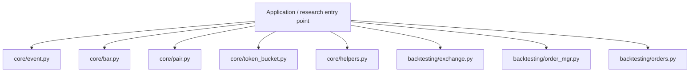
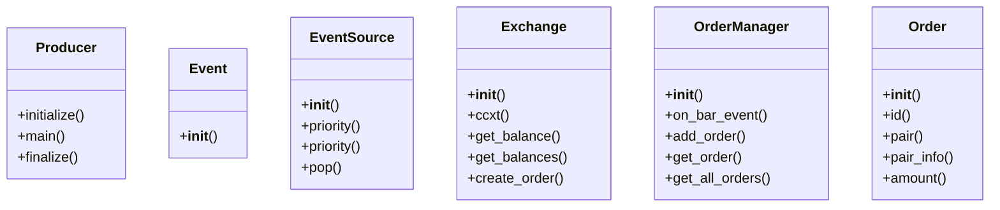
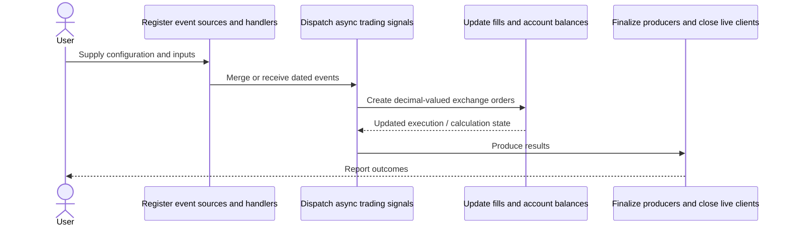
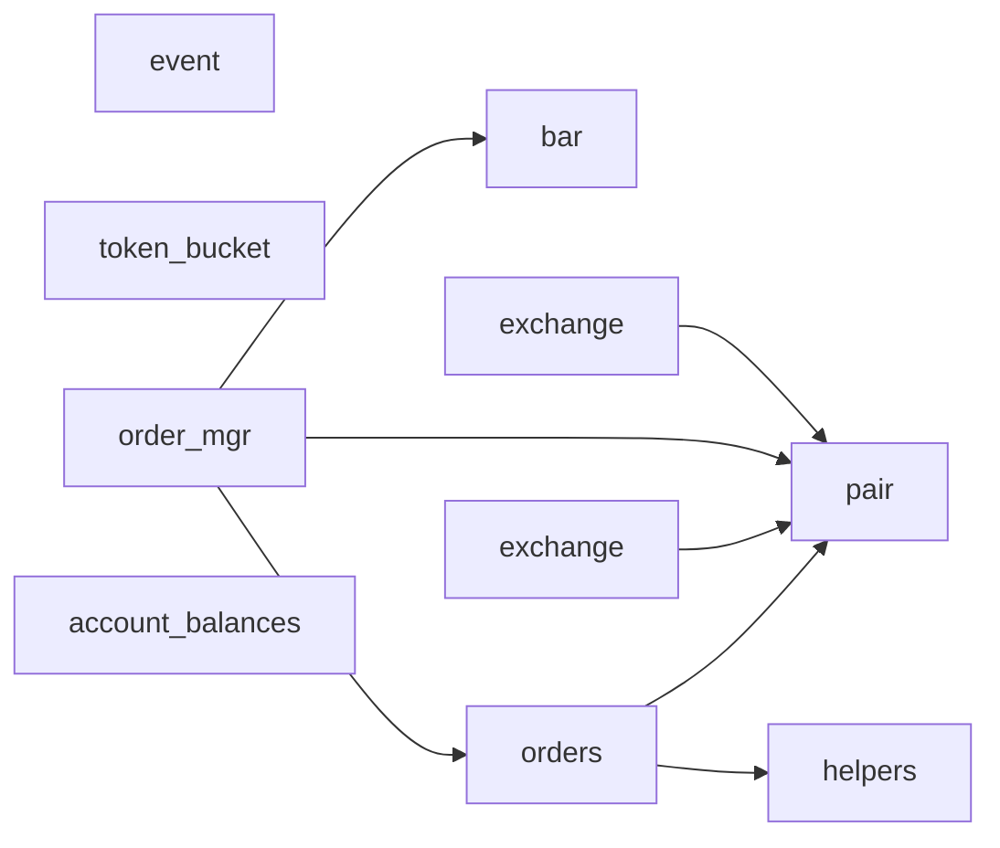
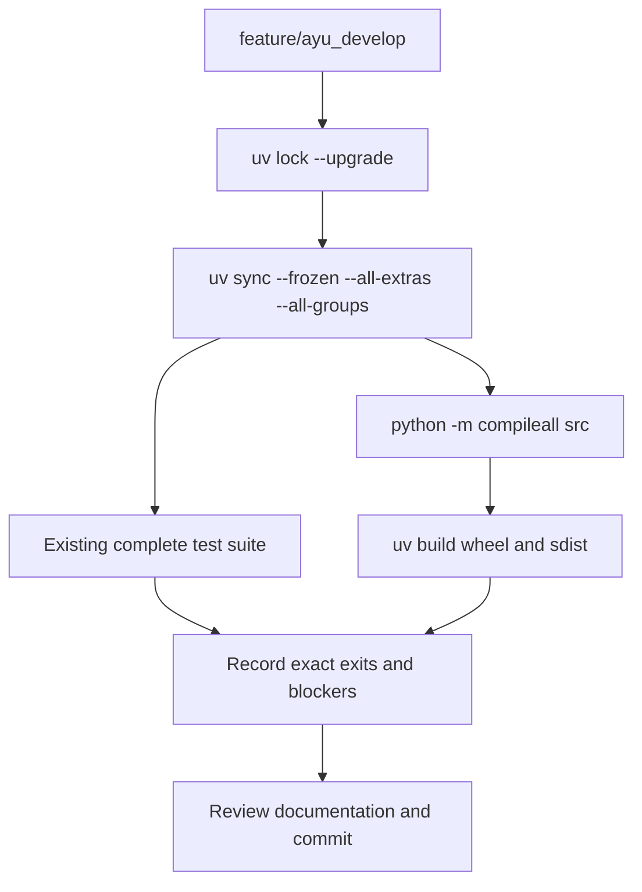

# basana: development, architecture and operations

Updated 2026-10-12 on `feature/ayu_develop`; source snapshot `619fa01ee7bd`. This guide follows the source in this checkout and separates available interfaces from verification evidence.

## Purpose and feature boundaries

Async event-driven crypto trading with chronological backtesting, realtime dispatching, exchange simulation and Binance, Bitstamp and CCXT integrations.

EventSource is passive and Producer controls active input lifecycle. Backtesting uses time ordering and serial dispatch by default; realtime uses concurrent async handlers. Decimal quantities and timezone-aware timestamps are invariants. Fees, liquidity and lending are pluggable simulation policies. CCXT is an optional integration; samples expose educational position managers outside the installed library.

## Main workflow

The following is the repository-specific logical workflow. Runtime execution details remain in the linked source and the validation record.

1. Register event sources and handlers.
2. Merge or receive dated events.
3. Dispatch async trading signals.
4. Create decimal-valued exchange orders.
5. Update fills and account balances.
6. Finalize producers and close live clients.

## Components and ownership

The entry point composes the source modules below; arrows indicate review/navigation boundaries rather than a claim that every module is called in every run.

| Source | Declared classes / functions | Implementation role |
|---|---|---|
| [src/basana/core/event.py](../src/basana/core/event.py) | Producer, Event, EventSource, FifoQueueEventSource | See the public declarations and implementation linked here. |
| [src/basana/core/bar.py](../src/basana/core/bar.py) | InvalidBar, Bar, BarEvent, RealTimeTradesToBar | See the public declarations and implementation linked here. |
| [src/basana/core/pair.py](../src/basana/core/pair.py) | Pair, PairInfo | See the public declarations and implementation linked here. |
| [src/basana/core/token_bucket.py](../src/basana/core/token_bucket.py) | TokenBucketLimiter | See the public declarations and implementation linked here. |
| [src/basana/core/helpers.py](../src/basana/core/helpers.py) | TaskGroup, TaskPool, LazyProxy; get_quantizer, no_raise, use_or_create_session, round_decimal | See the public declarations and implementation linked here. |
| [src/basana/backtesting/exchange.py](../src/basana/backtesting/exchange.py) | Balance, CreatedOrder, CanceledOrder, OpenOrder, Exchange | See the public declarations and implementation linked here. |
| [src/basana/backtesting/order_mgr.py](../src/basana/backtesting/order_mgr.py) | ExchangeContext, OrderEvent, OrderManager; round_balance_updates, round_fees | See the public declarations and implementation linked here. |
| [src/basana/backtesting/orders.py](../src/basana/backtesting/orders.py) | OrderState, Fill, OrderInfo, Order, MarketOrder, LimitOrder; slipped_price | See the public declarations and implementation linked here. |
| [src/basana/backtesting/account_balances.py](../src/basana/backtesting/account_balances.py) | UpdateRule, NonZero, ValidHold, AccountBalances | See the public declarations and implementation linked here. |
| [src/basana/external/binance/exchange.py](../src/basana/external/binance/exchange.py) | PairInfoEx, Exchange; get_filter_from_symbol_info | See the public declarations and implementation linked here. |
| [src/basana/external/bitstamp/exchange.py](../src/basana/external/bitstamp/exchange.py) | TransactionType, OpenOrder, OrderStatusTransaction, OrderStatus, OrderInfo, Balance | See the public declarations and implementation linked here. |
| [src/basana/external/ccxt/exchange.py](../src/basana/external/ccxt/exchange.py) | Balance, OrderInfo, CanceledOrder, CreatedOrder, Exchange | See the public declarations and implementation linked here. |
| [src/basana/__init__.py](../src/basana/__init__.py) | Package data / configuration | See the public declarations and implementation linked here. |
| [src/basana/backtesting/__init__.py](../src/basana/backtesting/__init__.py) | Package data / configuration | See the public declarations and implementation linked here. |

## Class design

Methods and inheritance edges are taken from the selected declarations in the actual source. A missing edge means composition or an external base is not asserted here.

## End-to-end interaction

This sequence presents the responsibilities of the main workflow, including the state/result boundary. The linked classes and functions provide the exact method-level contract.

## Source dependency direction

These edges are actual explicit imports between the selected source modules. Dynamic imports, re-exports and third-party internals are omitted.

## Design details and extension points

### `Producer`

Source: [src/basana/core/event.py](../src/basana/core/event.py).

Base class for producers.

- `initialize`: Override to perform initialization.
- `main`: Override to run the loop that produces events.
- `finalize`: Override to perform cleanup.

### `Event`

Source: [src/basana/core/event.py](../src/basana/core/event.py).

Base class for events.

### `EventSource`

Source: [src/basana/core/event.py](../src/basana/core/event.py).

Base class for event sources.

- `priority`: See implementation for the complete contract.
- `priority`: See implementation for the complete contract.
- `pop`: Override to return the next event, or None if there are no events available.

### `Exchange`

Source: [src/basana/external/ccxt/exchange.py](../src/basana/external/ccxt/exchange.py).

A client for crypto currency exchanges through `CCXT <https://github.com/ccxt/ccxt>`_.

- `ccxt`: The underlying CCXT exchange instance.
- `get_balance`: Returns the balance for a specific currency/symbol/etc..
- `get_balances`: Returns all balances.
- `create_order`: See implementation for the complete contract.
- `create_market_order`: Creates a market order.

### `OrderManager`

Source: [src/basana/backtesting/order_mgr.py](../src/basana/backtesting/order_mgr.py).

Manages orders and full lifecycle in a backtesting environment.

- `on_bar_event`: See implementation for the complete contract.
- `add_order`: See implementation for the complete contract.
- `get_order`: See implementation for the complete contract.
- `get_all_orders`: See implementation for the complete contract.
- `get_open_orders`: See implementation for the complete contract.

### `Order`

Source: [src/basana/backtesting/orders.py](../src/basana/backtesting/orders.py).

The class contract is defined by its linked implementation.

- `id`: See implementation for the complete contract.
- `pair`: See implementation for the complete contract.
- `pair_info`: See implementation for the complete contract.
- `amount`: See implementation for the complete contract.
- `operation`: See implementation for the complete contract.

## Repository layout and resources

Installable packages live under `src/`. `pyproject.toml` defines package metadata, build requirements, optional integrations and development dependencies; `uv.lock` records resolved versions, and `.python-version` selects the local interpreter. This layout keeps an accidental checkout import from substituting for the installed wheel. Package resources remain beside their owning modules and are included by the build backend. Existing upstream examples, fixtures, scripts and documentation retain their separate roles.

## Maintenance compatibility and evidence

- The full existing suite passes 445 cases and covers every one of 5535 source statements (100.00%). Deprecated API assertions use deprecated_call and retain their original value assertions.
- The simulator logs use the current fill.price field; log timestamps are included in pytest log formatting so the existing logging assertion remains meaningful. CSV/JSON input files close deterministically.
- Latest CCXT requires aiohttp 3.14; current aioresponses 0.7.9 needs the documented stream_writer mock patch. See vendor/aioresponses/PROVENANCE.md and original retained license.
- The source-build Python 3.15 attempt fails compiling pycares 5.1.0, required by aiohttp speedups. Native build evidence is retained.
- Invoke lint validates 95 owned Python files. Verified third-party vendor source retains its upstream lint conventions and is excluded from the project Ruff scan.

## Development and verification workflow

See [development commands](development.md) and [validation evidence](validation.md) for interpreter selection, dependency exceptions, full-suite results and remaining blockers. No additional test cases were introduced by this maintenance.
